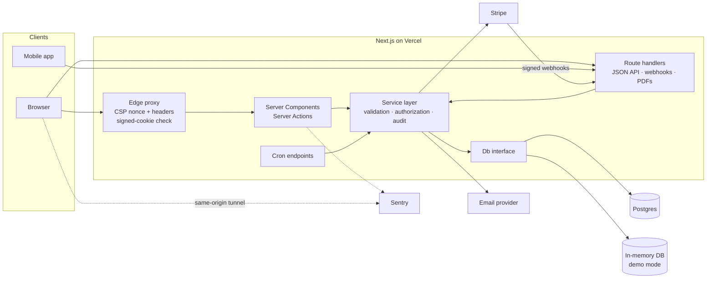
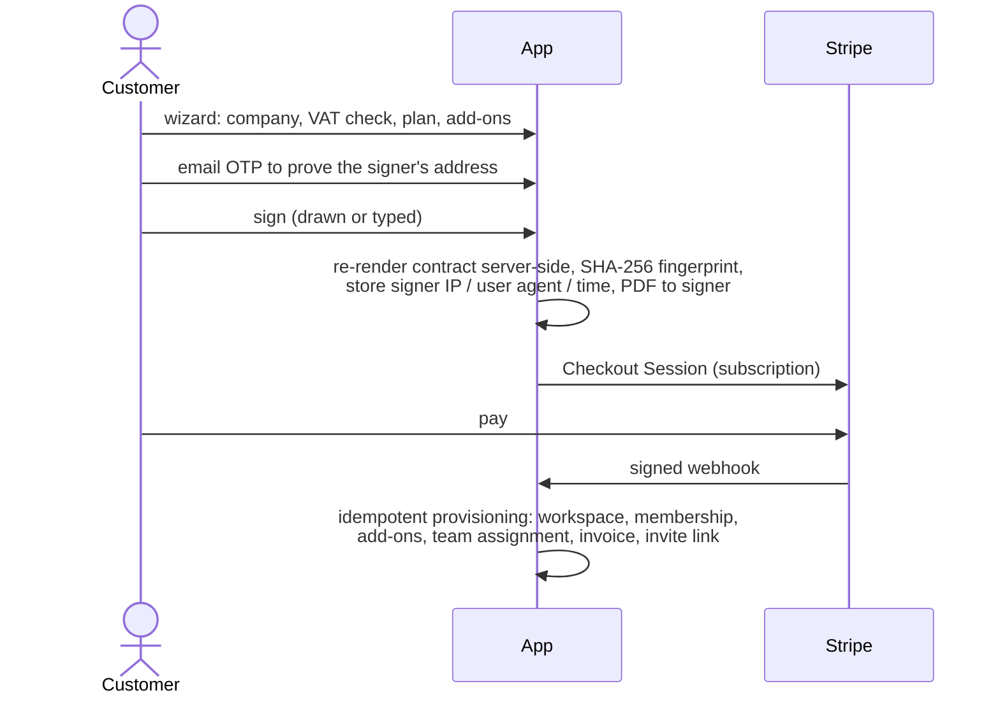

# SpringMarket Platform — case study

*An agency's whole operation in a single Next.js app: public site, self-serve contracting with e-signature and Stripe, and portals for clients, team and admins.*

Author: Teferi Laforga · Role: sole designer, developer and operator · Live site: [springmarket.es](https://springmarket.es)

> The source code is private because it runs a live business and handles client contracts, invoices and personal data. This repository describes the architecture and the engineering decisions, with a few simplified code excerpts in [`excerpts/`](excerpts/). It contains no client data and no production configuration.

**Contents:** [Problem](#the-problem) · [Stack](#stack) · [Architecture](#architecture) · [Authentication](#authentication-without-an-auth-vendor) · [Contracting flow](#contracting-e-signature--payment--provisioning) · [Observability](#observability-and-operations) · [Bugs worth telling](#bugs-worth-telling) · [Code excerpts](#code-excerpts)

---

## The problem

A small digital agency needed to stop running sales, contracts, payments and delivery across email, PDFs and spreadsheets. The goal was one system where:

1. a prospect can go from "I'm interested" to "signed and paid" without a call, and becomes a client with a working portal automatically;
2. clients see their requests, deliveries, documents, invoices and reports in one place, and manage their own plan;
3. the team sees only the clients they are assigned to, tracks time and gets work reviewed;
4. the admin runs CRM, finance, contracts, content and operations, with an audit trail.

The same backend also serves a companion mobile app (Expo) through a JSON API.

## Stack

Next.js 16 (App Router, Server Components, Server Actions, edge `proxy.ts`) · React 19 · TypeScript · Tailwind 4 · Neon serverless Postgres · custom authentication · Stripe (Checkout, Subscriptions, Billing Portal, webhooks) · Resend · `@react-pdf/renderer` · Sentry · zod · Vitest · Vercel (Cron) · GitHub Actions + Dependabot.

## Architecture

- **One `Db` interface, two implementations.** With a database URL the app uses Postgres; without one it uses an in-memory store seeded with fictional data. The in-memory store emulates the real unique constraints, so tests fail on the same data Postgres would reject, and anyone can run the full product locally with zero credentials and sign in as any role.
- **One source of domain types**, mirrored by an idempotent SQL schema plus numbered migrations (16 so far), with a script that detects drift between the types and the live schema.
- **Every Server Action goes through one wrapper** that validates input with zod, checks role and admin scope, measures latency against an SLO and writes structured logs. Relevant mutations write an append-only audit log.
- **A job queue in Postgres** with exponential retries and deduplication keys moves email, push notifications and outgoing webhooks out of the request path. 16 Vercel Cron schedules drive it plus SLA checks, dunning, renewals, digests, reports and cleanup.

## Authentication without an auth vendor

Three roles (client, team member, admin), with optional admin scopes (sales, finance, ops, content).

- **Two layers.** The edge proxy only verifies the HMAC signature of the session cookie (fast, no DB). Layouts and actions then check the session row, the role and the ownership of the resource being touched. The mobile API uses per-table policies: row-scope filters, field projection, and deny-by-default for internal tables.
- **Sessions** are a signed `__Host-` cookie plus a revocable DB row: absolute and idle expiry, sliding renewal, a cap on live sessions per user, and a session list where users can revoke devices. The mobile app presents the same session as a bearer token.
- **Credentials:** scrypt with transparent re-hashing when parameters are raised, leaked-password check via k-anonymity, lockout after repeated failures, constant-cost login against account enumeration; single-use magic links consumed by POST, email OTP with attempt limits, Google OAuth with state + PKCE, and TOTP 2FA (encrypted secrets, hashed recovery codes) that is mandatory for admins.
- **Impersonation** for support: an admin can view the portal as a non-admin user through a separate signed cookie, with a required reason, a visible banner, an audit entry and a notification to the other admins. It is read-only unless write access is explicitly requested.

## Contracting: e-signature + payment + provisioning

Decisions that mattered:

- **The server never trusts the contract the browser shows.** It re-renders the text from stored data and hashes it. The fingerprint is printed on the PDF and anyone can confirm it on a public verification page, which reveals nothing personal.
- **Signer email verification is on by default in production.** An internal audit showed that without it anyone could sign in the name of a company and an email they did not control.
- **Webhooks are treated as hostile and repeatable:** signature check, rejection of test events against live keys, the event id is reserved *before* processing so two concurrent deliveries cannot both run, a lock around provisioning, provisioning only for contracts already signed and backed by a verifiably paid invoice. If a customer manages to pay twice, the duplicate subscription is cancelled automatically and an admin alert is raised.
- **Self-service billing afterwards:** plan changes with a proration preview, add-ons, pause/resume, cancellation and the Stripe Billing Portal, all from the client portal.

## Observability and operations

- Sentry in the browser, Node and edge runtimes, errors + traces with sampling, **no PII and no session replay** (the site promises no third-party tracking without consent). Browser events go through a same-origin tunnel, so the strict CSP stays closed to third-party hosts and ad blockers do not swallow errors.
- A dependency-free JSON logger that masks emails, tokens and database row values before anything is written.
- Configuration is validated at boot: in production the app refuses to start if any link of the "sign → charge → email → cron" chain is missing, instead of failing after a customer has already signed.
- A health endpoint (DB latency, version, integrations, queue state), ops alerts from cron, and CI with lint, type-check, tests with coverage thresholds, dependency audit, build and a smoke test that also asserts no prices leak onto public pages.

## Bugs worth telling

- **The redirect loop between edge and server.** The edge proxy decides "logged in" from the cookie signature alone; the server decides from the session row. When a cookie is still cryptographically valid but its session was revoked or expired, each layer sent the user to the other's territory forever (`ERR_TOO_MANY_REDIRECTS`), locking them out until they cleared cookies by hand. The fix routes that case to a sign-out endpoint that deletes the dead cookie, instead of a plain redirect that only dodged the loop.
- **A session id shared between requests.** An internal audit flagged that the current session id was kept in a module-level variable. With several concurrent requests served by the same serverless instance, they could overwrite each other's value, so signing out could revoke someone else's session. The id now travels inside each request's session object.

## Process

- Three rounds of written internal audits (backend, portals, public site), with findings tracked by ID and closed in commits.
- 27 Vitest suites covering auth, security headers, policies, onboarding and billing, the Stripe webhook, email templates, CRM and the API.
- Dependabot for npm and GitHub Actions; least-privilege database role and statement timeouts defined in SQL.

## Code excerpts

Simplified extracts from the private codebase (comments translated, helpers omitted). They illustrate the approach; they are not meant to compile on their own.

| File | Shows |
|---|---|
| [`excerpts/signed-token.ts`](excerpts/signed-token.ts) | HMAC-signed tokens with WebCrypto, usable from the edge proxy |
| [`excerpts/roles-and-actions.ts`](excerpts/roles-and-actions.ts) | Roles, admin scopes, `requireRole` for layouts and the `action()` wrapper for Server Actions |
| [`excerpts/sign-contract.ts`](excerpts/sign-contract.ts) | Public signing action: resume token, rate limit, server-side re-render + hash, Checkout |
| [`excerpts/stripe-webhook.ts`](excerpts/stripe-webhook.ts) | Webhook signature check, livemode guard, idempotency by reserving the event id |

## What I would do next

- Move file storage (signatures, PDFs) from a database table to private object storage with signed URLs.
- Stand up a real staging environment with database branching for every pull request (the CI job is prepared but not enabled).
